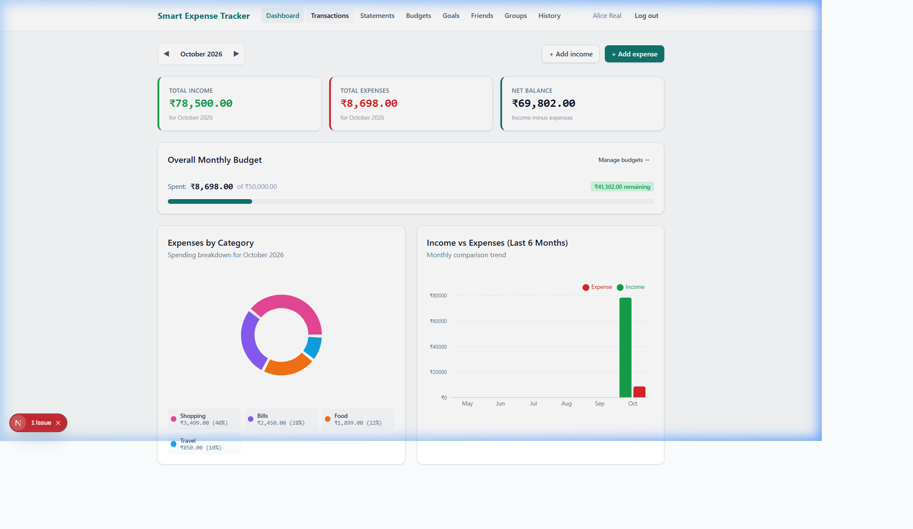
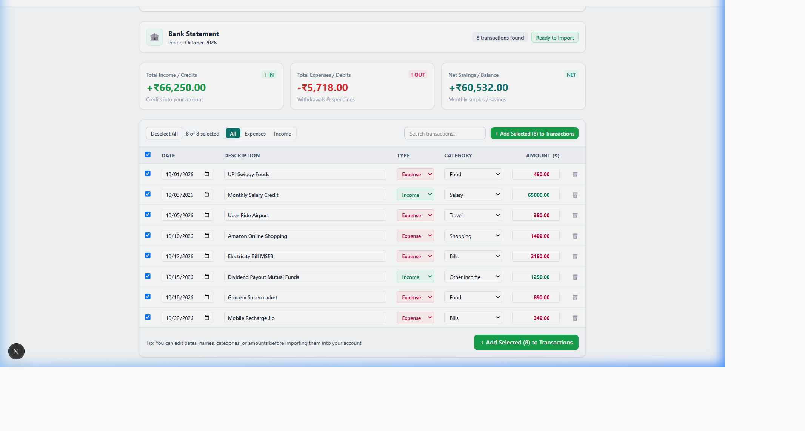
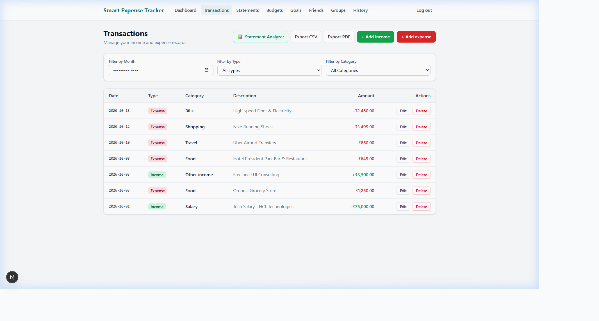
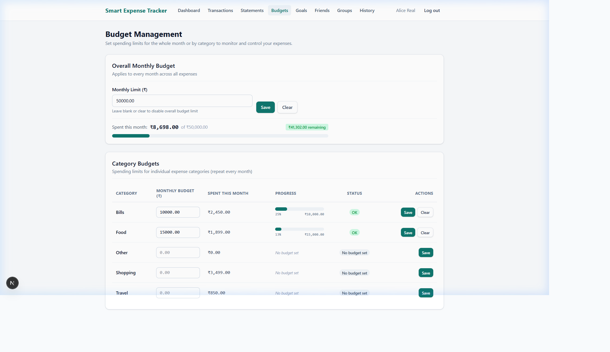
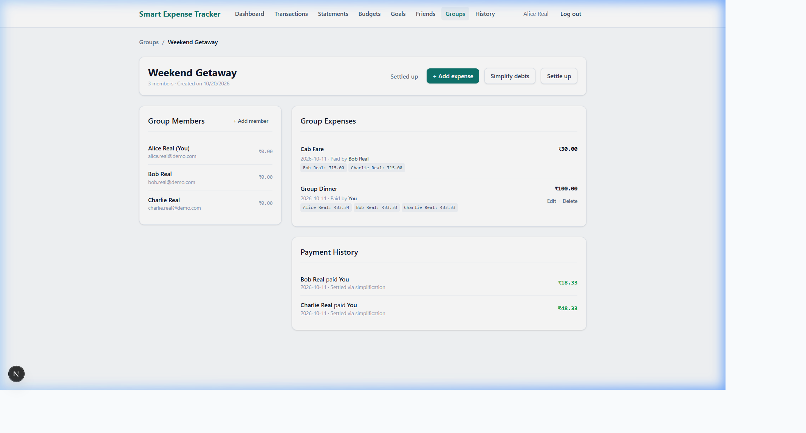

# 💰 Smart Expense Tracker

<div align="center">


<p align="center">
  <b>A modern, AI-powered personal finance & shared group expense tracker built with Next.js 16, Prisma 7, SQLite, and Google Gemini AI.</b>
</p>

[Key Features](#-key-features) • [Screenshots](#-screenshots) • [Tech Stack](#-tech-stack) • [Getting Started](#-getting-started) • [API Reference](#-api-reference)

</div>

---

## 🌟 Overview

**Smart Expense Tracker** is a comprehensive financial platform engineered to eliminate manual money tracking errors. It combines individual budgeting and savings goals with intelligent group bill splitting, automated debt simplification algorithms, and cutting-edge **Google Gemini AI** for receipt scanning and monthly bank statement analysis.

All monetary amounts are strictly computed and persisted in integer minor units (paise/cents) to ensure zero floating-point arithmetic errors.

---

## ✨ Key Features

### 🤖 AI-Powered Automation
- **AI Physical Receipt Scanner**: Upload any bill image (JPG, PNG, WEBP up to 5 MB) to automatically extract the merchant name, date, line items, and total payable amount with Google Gemini AI.
- **Monthly Bank Statement Analyzer**: Upload statement PDFs, CSVs, or scanned document images (up to 10 MB). The AI extracts the statement period, bank name, net cashflow, deposits, and categorizes every transaction against your system categories.
- **Interactive Batch Import**: Review AI-parsed statement transactions, customize dates/categories/amounts inline, and import all or selected transactions into your ledger with a single click.

### 📊 Personal Money Management
- **Transactions Ledger**: Track Income and Expense transactions with date, category, and description filters.
- **Interactive Visual Dashboard**: Real-time spending charts, category breakdowns, and monthly net cashflow metrics built with Recharts.
- **Budgeting Engine**: Set overall monthly spending budgets as well as category-specific limits with visual warning bars.
- **Savings Goals**: Track milestones with progress indicators, target completion dates, and incremental contributions.
- **Exporting**: One-click download of personal transaction history in **CSV** (with spreadsheet formula injection protection) and **PDF** formats.

### 👥 Group Expense Splitting & Debt Simplification
- **Shared Group Expenses**: Create friend groups (e.g. trips, flatmates, dining) and log shared bills.
- **Flexible Split Methods**:
  - **Equal**: Splits totals down to the exact paise without rounding drift (e.g. ₹100 among 3: ₹33.34, ₹33.33, ₹33.33).
  - **Percentage**: Assign percentage shares totaling 100%.
  - **Exact**: Allocate exact rupee amounts per person with live sum validation.
- **Smart Debt Simplification**: Built-in graph-based debt simplification algorithm that computes net balances across group members and reduces cyclic debts down to the minimal number of payments.
- **Settlement Recording**: Track when friends pay each other back with live balance recalculation.

---

## 📸 Screenshots

### 1. Dashboard & Financial Analytics
> Real-time cashflow overview, monthly budget progress bar, active savings goals, and recent activity.



---

### 2. AI Bank Statement Analyzer
> Upload monthly bank statements (PDF, CSV, Image) to extract income, expenses, and transaction tables with smart auto-categorization and batch import into your ledger.



---

### 3. Transactions Ledger
> Filter by month, transaction type, or category with one-click CSV and PDF export.



---

### 4. Budget & Goal Tracking
> Overall monthly budgets with category-level thresholds and visual progress indicators.



---

### 5. Group Expenses & Debt Simplification
> Track who owes whom with automatic debt minimization and settlement logging.



---

## 🛠️ Tech Stack

| Layer | Technology | Details |
| :--- | :--- | :--- |
| **Framework** | [Next.js 16](https://nextjs.org/) | App Router, Server Components & Route Handlers |
| **Frontend** | [React 19](https://react.dev/) | Hooks, Server/Client components |
| **Styling** | [Tailwind CSS 4](https://tailwindcss.com/) | Modern design tokens, responsive layouts, glassmorphism |
| **Database** | [SQLite](https://www.sqlite.org/) | Local persistent storage with WAL mode via `better-sqlite3` |
| **ORM** | [Prisma 7](https://www.prisma.io/) | Type-safe queries with `@prisma/adapter-better-sqlite3` |
| **AI Integration** | [@google/genai](https://github.com/googleapis/js-genai) | Fast multimodal models (`gemini-3.5-flash`, `gemini-3.8-flash`) |
| **Validation** | [Zod 4](https://zod.dev/) | Strict schema validation on API payloads |
| **Authentication** | [Jose](https://github.com/panva/jose) & [bcryptjs](https://github.com/dcodeIO/bcrypt.js) | Stateless HTTP-only JWT session cookies & salted password hashing |
| **Visual Charts** | [Recharts](https://recharts.org/) | Responsive SVG spending bar and pie charts |
| **Document Generation** | [PDFKit](https://pdfkit.org/) | Server-side printable PDF export |
| **Testing** | [Vitest 5](https://vitest.dev/) | Fast unit and integration tests (66 passing tests) |

---

## 🚀 Getting Started

### Prerequisites
- **Node.js** >= 20.0.0
- **npm** >= 10.0.0
- **Google Gemini API Key** (Get a free key from [Google AI Studio](https://aistudio.google.com/))

### 1. Clone the repository
```bash
git clone https://github.com/roshanawari/smart-expense-tracker.git
cd smart-expense-tracker
```

### 2. Install dependencies
```bash
npm install
```

### 3. Configure environment variables
Create a `.env` file in the root directory:
```env
DATABASE_URL="file:./dev.db"
SESSION_SECRET="your-secure-random-secret-key-at-least-32-chars"
GEMINI_API_KEY="your-google-gemini-api-key"
```

### 4. Initialize Database & Seed Categories
```bash
# Push Prisma schema to SQLite
npx prisma db push

# Seed initial categories (Food, Travel, Bills, Shopping, Salary, etc.)
npx tsx prisma/seed.ts
```

### 5. Start the Development Server
```bash
npm run dev
```

Open [http://localhost:3000](http://localhost:3000) in your browser.

---

## 🧪 Testing

The test suite covers authentication, transaction accounting, debt simplification algorithms, bill scanning, bank statement extraction, and exports:

```bash
# Run all tests with Vitest
npm test

# Run a specific test suite
npx vitest run tests/bank-statements.test.ts
npx vitest run tests/m7-f18-scan.test.ts
```

---

## 📁 Project Structure

```text
├── app/
│   ├── api/
│   │   ├── auth/            # Authentication endpoints (login, register, logout, me)
│   │   ├── bills/scan/      # Gemini AI receipt scanner route
│   │   ├── budgets/         # Monthly and category budget management
│   │   ├── categories/      # System categories endpoint
│   │   ├── expenses/        # Split expense creation and calculations
│   │   ├── friends/         # Friendship management
│   │   ├── goals/           # Savings goals API
│   │   ├── groups/          # Group management & debt simplification
│   │   ├── statements/      # AI bank statement analysis & batch import
│   │   └── transactions/    # CRUD transactions and CSV/PDF export
│   ├── budgets/             # Budget management view
│   ├── dashboard/           # Main financial dashboard with charts
│   ├── expenses/            # Shared expense creation & split calculator
│   ├── friends/             # Friends ledger & balances view
│   ├── goals/               # Savings goals tracking view
│   ├── groups/              # Groups & debt settlement view
│   ├── statements/          # Monthly bank statement analyzer view
│   └── transactions/        # Transaction ledger & filters view
├── components/
│   ├── dashboard-charts.tsx # Recharts visualization components
│   ├── navbar.tsx           # Responsive navigation bar
│   └── ui.tsx               # Reusable design system components (Card, Button, Input)
├── docs/
│   └── screenshots/         # Application feature screenshots
├── lib/
│   ├── auth.ts              # JWT session creation & verification
│   ├── db.ts                # Prisma SQLite client instance
│   ├── money.ts             # Integer paise currency utilities
│   ├── simplify.ts          # Minimal debt payment algorithm
│   └── split.ts             # Exact paise split calculations (Equal, %, Exact)
├── prisma/
│   ├── schema.prisma        # Database schema definitions
│   └── seed.ts              # Default categories seeder
└── tests/                   # Vitest unit & integration test suites
```

---

## 🔌 API Reference

| Method | Endpoint | Description |
| :--- | :--- | :--- |
| `POST` | `/api/auth/register` | Register a new user account |
| `POST` | `/api/auth/login` | Authenticate and set HTTP-only session cookie |
| `POST` | `/api/auth/logout` | Clear session cookie |
| `GET` | `/api/transactions` | Query personal transactions with month, type, category filters |
| `POST` | `/api/transactions` | Create a new income or expense transaction |
| `GET` | `/api/transactions/export` | Download CSV or PDF report |
| `POST` | `/api/bills/scan` | Multipart receipt upload parsed with Gemini OCR |
| `POST` | `/api/statements/analyze` | Upload bank statement (PDF/CSV/Image) for AI parsing |
| `POST` | `/api/statements/import` | Batch-create selected statement transactions |
| `GET` | `/api/budgets` | Fetch overall monthly and category budgets |
| `POST` | `/api/budgets` | Upsert monthly or category budget limit |
| `GET` | `/api/groups/:id/simplify`| Calculate simplified minimal settlement payments |
| `POST` | `/api/settlements` | Record a debt settlement between two users |

---

## 🔒 Security & Data Integrity

- **Paise Precision**: All currency stored as integer minor units (`amountMinor` in paise) — zero floating-point drift.
- **Formula Injection Safeguards**: CSV exports sanitize leading `=`, `+`, `-`, `@` characters to protect against spreadsheet formula injection.
- **Isolated User Scope**: Every resource query verifies ownership against the authenticated user ID.
- **Ephemeral AI Processing**: Scanned receipts and bank statements are processed purely in-memory buffers and never written to disk.

---


# smart-expense-tracker

